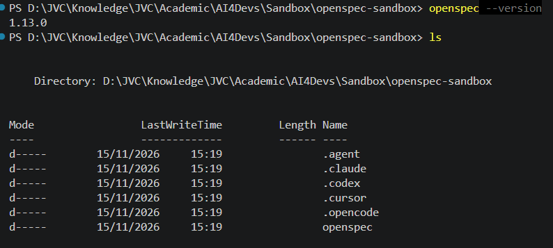

# Módulo 2 - Ejercicio

## Preparación Previa

## Parte A - Repaso de los 3 Pilares

*Micro-tarea:* Extracción de información detallada de facturas electrónicas del SRI - Ecuador en formato XML

*Pilar 1 — Herramienta:* python por su facilidad de uso para extaer información de XML y para tener una prueba de concepto de manera rápida

*Pilar 2 — Contexto:* información de ejemplo, varias facturas electrónicas en formato xml en la carpeta: D:\JVC\Academic\Lidr\AI4Devs\Sandbox\M2-01\Examples\1803066149001 el formato de la factura usa CDATA como estructura para la información, existen 2 secciones de información 1 la de la factura como tal que tiene los datos del receptor y del emisor de la factura y 2 los datos del detalle de los productos. 

*Pilar 3 — Prompt:*
obtén la información de las facturas electrónicas de la carpeta D:\JVC\Academic\Lidr\AI4Devs\Sandbox\M2-01\Examples\1803066149001, el resultado debe arrojar 2 tablas en formato csv que se asociarán entre si mediante una primary key que identificará unequívocamente a cada factura.Tabla 1 información de factura y tabla 2 información de productos.

*Resultado:* ¿Funcionó a la primera o tuviste que iterar?
Funcionó bien a la primera, lo que queda pendiente es extraer información adicional que quedó dentro del archivo en formato JSON

Una mejora que harías si volvieras a hacerlo.  
Especificar como se requiere obtener la información adicional de los campos personalizados de la factura.

## Parte B - Instalación de OpenSpec en sandbox
### Observaciones
- La metodología se asemeja a la definición de los Términos de Referencia (TDR's) que se utilizan en proyectos de ingeniería y construcción, donde el éxito del proyecto depende de cuan bien estén definidos los términos y el alcance del proyecto de manera que se pueda concluir dentro del tiempo y presupuesto especificado.
- Me llamó la atención el uso de archivos yaml para la configuración dada la facilidad para interpretarlos.
- Es preciso dedicarle el tiempo necesario al diseño conceptual del proyecto y probar en la fase inicial que ese concepto funciona antes de empezar a generar código.